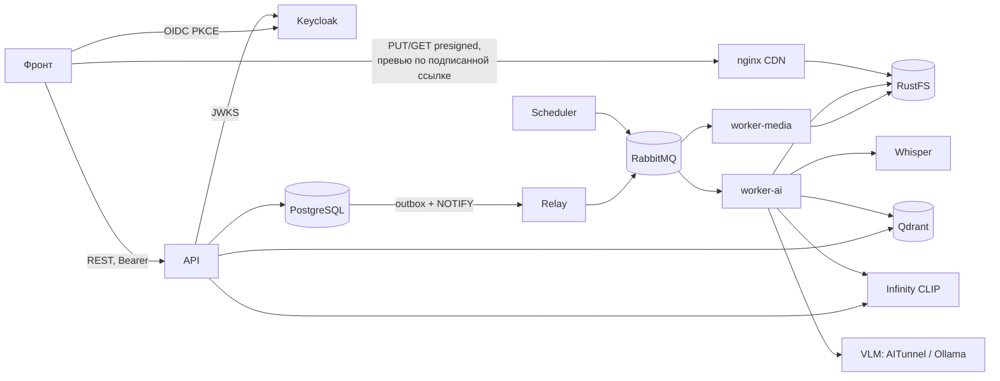

# Архитектура

Модульный монолит на [DDF](https://github.com/Andr171p/py-ddd-framework): один образ приложения,
разные процессы — API, relay событий, воркеры, планировщик.

## Контейнеры



| Сервис | Назначение |
|---|---|
| `api` | FastAPI: `/api/v1` (пользователи), `/api/admin/v1`, `/api/service/v1`, `/api/public/v1` |
| `relay` | Доставка доменных событий из outbox в очереди (at-least-once) |
| `worker-media` | Очередь `dam.media`: метаданные, превью, прокси видео/аудио, рендер редактора, очистка |
| `worker-ai` | Очередь `dam.ai`: CLIP-векторы, лица, ИИ-описание и теги, расшифровка речи, синхронизация индекса |
| `scheduler` | Периодические задачи (брошенные загрузки, корзина старше 30 дней) — один экземпляр |
| `migrate` | `alembic upgrade head` перед стартом приложения |
| `cdn` | nginx: подписанные ссылки на превью и прокси с кешем, проброс presigned-запросов к хранилищу |
| `rustfs` + `storage-init` | S3-хранилище, бакеты `dam-originals` (закрыт) и `dam-renditions` (читает только nginx) |
| `postgres` | База приложения и база Keycloak |
| `keycloak` | Identity: пользователи, вход, токены |
| `qdrant` | Векторы кадров (CLIP) и лиц |
| `infinity` / `infinity-gpu` | Эмбеддинги CLIP (изображения + мультиязычный текст) |
| `whisper` / `whisper-gpu` | Расшифровка речи (faster-whisper) |
| `ollama` (только gpu) | Локальная VLM для описаний и тегов |

Режим моделей выбирается `COMPOSE_PROFILES=cpu|gpu`: у CPU- и GPU-вариантов одинаковое сетевое имя.

## Слои

```text
src/
├── domain/        модели и инварианты: collections, assets, people, comments, selections, portals, users
├── application/   use cases (функции), DTO (camelCase), порты (Protocol), номинальные репозитории
├── infra/         SQLAlchemy, S3, CDN, Qdrant, Infinity, VLM, Whisper, ffmpeg/Pillow, OpenCV, TaskIQ, outbox
└── api/           роутеры по потребителям, зависимости FastAPI, обработка ошибок
```

* Домен не знает об инфраструктуре; методы агрегатов — только для настоящих инвариантов,
  остальное — доменные функции (`domain/assets/logic.py`) или простые изменения в use case.
* Use cases — функции с явными зависимостями; одни и те же вызываются из HTTP и из воркеров.
* Транзакцию фиксирует use case (`uow.commit()`), репозитории не коммитят. UoW — `AsyncSession`.
* Фоновые задачи не держат транзакцию во время долгой работы с файлами.

## Фоновые процессы

События сохраняются в `outbox_messages` в той же транзакции, что и изменения (Transactional Outbox DDF).
Relay просыпается по `NOTIFY` и ставит задачи:

| Событие | Задачи |
|---|---|
| `assets.version_added` | `media.process_version` |
| `assets.version_processed` | `ai.index_visuals`, `ai.detect_faces`, `ai.annotate`, `ai.transcribe` |
| `assets.current_version_changed`, `moved`, `trashed`, `restored`, `purged` | `ai.sync_asset` |
| `people.face_assigned` | `ai.propagate_face` |

Все задачи идемпотентны (повторная доставка безопасна), ошибки повторяются с экспоненциальной задержкой
(очереди `*.delay`), исчерпавшие попытки уходят в `*.dead_letter`.

Редактор ставит задачу `media.render_edit` напрямую: идентификаторы результата выданы заранее, поэтому
повтор не создаст дубликат.
