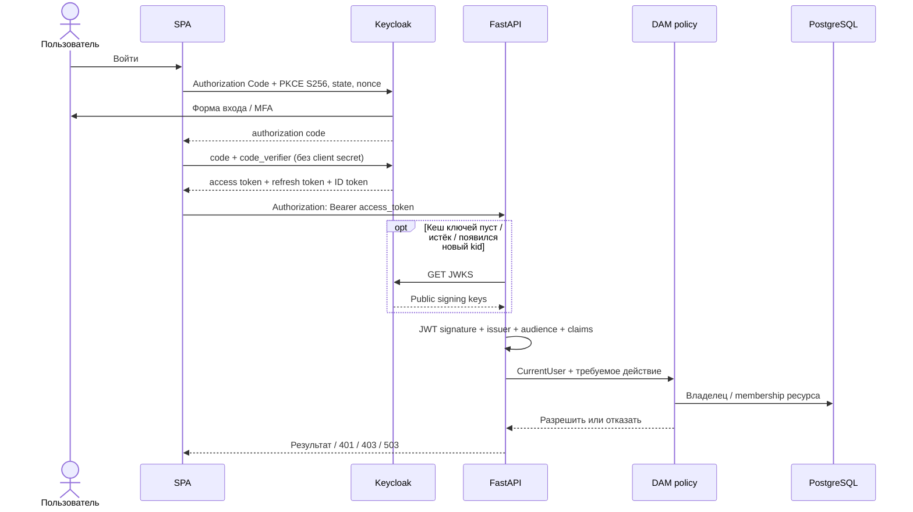
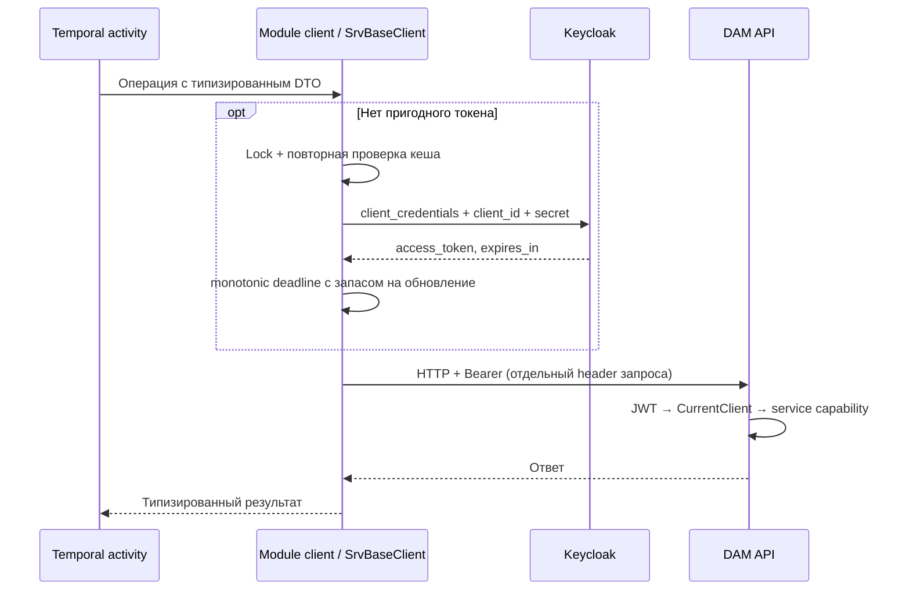

# Аутентификация и авторизация TIU Media Hub

## Решение и границы

Backend — OAuth resource server. Keycloak аутентифицирует пользователей и сервисы;
DAM принимает access token и сам решает, разрешено ли действие над ресурсом.
Backend не хранит пароли и не выпускает собственные JWT.

Модули разделены по ответственности:

| Компонент | Ответственность |
|---|---|
| `core/auth/dtos.py` | Неизменяемые `CurrentUser`, `CurrentClient`, discriminated union `CurrentAuth` |
| `core/auth/policies.py` | Проверка application roles без зависимости от HTTP |
| `core/auth/exceptions.py` | Ошибки credentials, доступности IdP и доступа к ресурсу |
| `core/keycloak/claims.py` | Типизированный контракт проверенных claims → principal |
| `core/keycloak/client.py` | Асинхронный JWKS cache и локальная проверка JWT |
| `modules/auth/dependencies.py` | Bearer → principal; проверки типа и ролей; HTTP 401/403/503 |
| `core/collections/authorization.py` | Политика коллекции и выборка владельца/членства из БД |
| `core/assets/authorization.py` | Политика существующих assets, пока у них нет collection_id |
| `core/services/base` | Исходящие OAuth Client Credentials, HTTP pool и token cache |
| `main.py` | Composition root, lifespan, маршруты, обработчик 403 и CORS |

`KeycloakClient` создаётся в lifespan приложения, передаётся через dependency
`get_keycloak_client` и закрывается при shutdown. Ключи загружаются лениво:
для запуска API доступность Keycloak не требуется. У каждого worker-процесса свой кеш.
`SrvBaseClient` создаётся один раз на время работы вызывающего процесса.
Его можно использовать через `async with` либо закрыть в lifespan через `close()`.

Существующий `KeycloakUsersClient` — заготовка Admin API, она не участвует
в аутентификации. Поиск пользователей для назначения membership следует реализовать
отдельным исходящим клиентом на базе `SrvBaseClient` с ограниченными admin permissions.
Проверка каждого запроса к DAM не должна обращаться к Admin API.

## Principal и контракт токена

`CurrentUser.id` — UUID из проверенного `sub`. Профиль необязателен:
username, email, full_name могут отсутствовать. `email_verified` передаётся отдельно;
наличие email не означает подтверждение адреса и не даёт прав.

`CurrentClient.client_id` — проверенный `azp`, например `tiu-media-hub-worker`.
`sub` сервисного токена обязателен и непустой, но UUID внутреннего service-account
Keycloak не становится идентификатором пользователя DAM.

Тип определяется обязательным подписанным claim `auth_type=user|client`.
Это **наш контракт**, добавленный hardcoded protocol mapper в Keycloak.
Одновременно проверяются непересекающиеся allowlist:
`KEYCLOAK_USER_CLIENT_IDS` и `KEYCLOAK_SERVICE_CLIENT_IDS`.
Отсутствующий claim, неизвестный клиент или несоответствие типа отклоняются.
Имя вида `service-account-*`, email, наличие роли или формат `sub`
не используются как эвристика.

Для корректности этого контракта web-клиент имеет только Standard Flow + PKCE S256,
а worker — только Service Accounts. Не включать пользовательский login или token
exchange у service-клиента с hardcoded `auth_type=client`: смена flow потребует
отдельного контракта principal. Пользовательские атрибуты не должны переопределять
`auth_type` или роли.

Backend принимает только роли из `resource_access["tiu-media-hub-api"].roles`.
Realm roles и роли других клиентов игнорируются, даже если называются `admin`.
По умолчанию отсутствие API roles не мешает получить `/auth/me`, но не даёт
прав создавать или читать чужие ресурсы.

Для JWT проверяются подпись, настроенный RSA-алгоритм, соответствие алгоритму JWK,
`iss`, `aud`, `exp`, `iat`, `sub`, `azp`, `typ`, `auth_type`;
`nbf` проверяется, если есть. `typ` в payload должен быть `Bearer`.
ID token и refresh token не принимаются. Значение алгоритма из заголовка
сверяется с конфигурацией, но не определяет разрешённые алгоритмы.

## Flow пользователя



Для SPA использовать OIDC/Keycloak adapter: он ведёт state/nonce/PKCE,
обновляет access token и выполняет OIDC logout. Токены держать в памяти SPA;
не помещать client secret в браузер. Для production настроить HTTPS, точные
redirect URI и origins. CORS API задаётся через `API_CORS_ORIGINS`;
он не заменяет авторизацию.

`GET /api/v1/users/me` возвращает только пользователя; сервис получает 403.
`GET /api/v1/auth/me` возвращает оба типа principal, с discriminator `type`.
Backend login/password/refresh endpoint не требуется: этот flow принадлежит Keycloak.

## Flow сервиса и Temporal



Реализованный `core/services/assets/client.py` скрывает транспорт за операцией:

```python
from uuid import UUID

from src.core.assets.dtos import AssetResponse
from src.core.services.base import SrvBaseClient


class AssetsClient(SrvBaseClient):
    async def get_asset(self, asset_id: UUID) -> AssetResponse:
        return await self.request_json("GET", f"assets/{asset_id}", AssetResponse)
```

Base URL в примере включает `/api/v1/`. Такой клиент передаётся в activity
при инициализации worker. Workflow не получает HTTP session, токены и секреты
и не обращается к Keycloak. В истории Temporal допустим идентификатор инициатора,
но не его Bearer token. Инициатор действия и аутентифицированный worker —
разные участники: нельзя превращать client_id в author UUID.

`SrvBaseClient`:
- читает стандартный OAuth `expires_in`, вычисляет срок по monotonic от начала запроса;
- ограничивает margin половиной lifetime для коротких токенов;
- объединяет конкурентные обновления через lock с повторной проверкой;
- использует долгоживущую aiohttp session с timeout, ограниченным pool и TLS verification;
- хранит secret/token через `SecretStr`, не печатает тело ошибки token endpoint;
- передаёт Authorization на каждый запрос, не меняя общие headers session;
- принимает пути внутри base URL, не пересылает Bearer на произвольный URL и не следует redirect;
- после 401 инвалидирует только тот token state, который отклонил сервер;
- автоматически повторяет GET/HEAD/OPTIONS после 401 максимум один раз;
- не повторяет POST/PATCH/PUT/DELETE автоматически. Для гарантированно идемпотентной
  операции модульный клиент может использовать `_request(..., retry_unauthorized=True)`;
- не повторяет другие HTTP ошибки и сетевые сбои: политику retry определяет вызывающий
  слой, учитывая идемпотентность операции.

Сервисные capabilities сейчас дают чтение всех assets (`assets:read`) и активных
коллекций (`collections:read`). Это доверенный внутренний worker, не внешний
клиент отдельного арендатора. Для ограниченного доступа сервиса к конкретным
коллекциям понадобится отдельная таблица grants и её проверка;
текущие service roles нельзя выдавать таким клиентам.

## Авторизация ресурсов

`require_roles("user", "admin")` требует хотя бы одну роль.
`require_roles("a", "b", all_required=True)` требует обе.
Пустой набор — ошибка конфигурации. Роль сама по себе не меняет тип principal:
сервис с ролью admin не становится пользователем.

| Principal / роль коллекции | Читать | Добавлять assets | Управлять коллекцией |
|---|---|---|---|
| Пользователь-владелец по owner_id | Да | Да | Да |
| Пользователь с API admin | Да | Да | Да |
| CONTRIBUTOR | Да | Да | Нет |
| VIEWER | Да | Нет | Нет |
| Посторонний | Нет | Нет | Нет |
| Сервис с collections:read | Да | Нет | Нет |

Неактивные/удалённые коллекции закрыты для обычных операций, включая admin.
Восстановление будет отдельной административной операцией.
Источник ownership — `Collection.owner_id`.
Старая запись membership с ролью OWNER у другого пользователя не даёт полномочий.
При реализации mutation membership нужно запретить создание таких записей;
смена владельца должна атомарно менять owner_id. Проверка читает только нужные
колонки, фильтрует удалённое членство и конкретного текущего пользователя;
ORM relationships не загружаются.

**Граница текущей реализации:** collection endpoints в репозитории — заглушки,
а у Asset нет collection_id. Поэтому политика коллекций реализована и покрыта
тестами, но не выдаётся за уже встроенную в asset lifecycle.

Существующие asset endpoints защищены следующим образом:
- создание — только CurrentUser с API user/admin; author_id берётся из principal;
- чтение — автор с user, пользователь admin или сервис с assets:read;
- начало и подтверждение загрузки — автор с user либо пользователь admin;
- assets без автора доступны только admin и сервисному читателю.

Для следующего этапа DAM нужна миграция с обязательным Asset.collection_id,
backfill существующих данных и вызов `authorize_collection` перед чтением/записью.
Generic CRUD остаётся механизмом persistence, не местом глобальной политики.
Списковые endpoints должны фильтровать доступные ресурсы непосредственно в SQL.

## Ошибки, кеши и эксплуатация

| Ситуация | Ответ |
|---|---|
| Нет Bearer / неверная подпись / claims / неизвестный kid | 401 + WWW-Authenticate |
| Валидный principal, нет роли / неподходящий тип / нет доступа | 403 |
| JWKS недоступен или некорректен, пригодного ключа нет | 503 + Retry-After |

JWKS TTL по умолчанию 300 секунд. Истёкший кеш обновляется даже для известного kid.
Новый kid вызывает одно принудительное обновление свежего кеша. Последующие
неизвестные kid ограничены общим cooldown 5 секунд, включая конкурентные запросы;
при нескольких быстрых ротациях новый ключ может начать приниматься после cooldown.
Неудачные обращения также ограничены cooldown. Ключ из ещё действующего кеша
позволяет продолжить работу при кратком сбое IdP; истёкший кеш не используется.

Локальная JWT-проверка не обеспечивает мгновенный отзыв уже выданного токена.
Logout, отключение пользователя или изменение глобальных ролей становятся видимыми
после истечения access token. Настраивать короткий access-token lifetime.
Изменение membership проверяется в БД на каждом действии.
Не использовать introspection на каждый обычный API-запрос.

Auth не требует новой таблицы users/services и не меняет схему identity.
Для audit-полей сервисных действий в будущем нужен типизированный actor
(`user + UUID` либо `client + client_id`) или отдельная сущность principal.
Текущие author_id остаются исключительно пользовательскими UUID.

## Что было исправлено при интеграции

Исходный проект имел несуществующие импорты User/AuthenticationError, некорректный
discriminator type, инвертированную проверку ролей, неработающую ротацию JWKS,
создание HTTP session на каждый запрос ключей, падение первого обращения
SrvBaseClient, ожидание expires_at вместо expires_in и изменение общих headers.

Для запуска реального приложения также исправлены пустой main.py, URI БД,
yield dependency БД, отсутствующий tablename AssetDerivative, неоднозначный FK
AssetVersion.asset и алиасы ORM → AssetResponse. Это блокеры запуска, обнаруженные
проверкой интеграции. Миграций в исходном проекте нет; объявление asset_derivatives
закрепляет имя ранее неработавшей модели. Существующую БД нужно сверить с metadata
перед введением миграций; приложение не вызывает create_all автоматически.

Обработка media/Temporal/S3 остаётся незавершённой в исходном проекте.
В частности, confirm upload ещё не реализует полноценный signal и durable связь
upload_id → asset_id, а workflows отсутствуют. Авторизация пользователя добавлена,
но это не означает готовность upload pipeline к эксплуатации. До реализации signal
нужно проверять эту связь, затем обеспечить идемпотентное подтверждение и retry.

## Проверка

```powershell
uv run python -m unittest discover -s tests -v
uv run python -m tests.check_keycloak
```

Обычные тесты используют реальные RSA-подписи, временные aiohttp-серверы и FastAPI
ASGI transport. Проверяют claims, тип principal, границы ролей, JWT/JWKS ошибки,
ротацию/кеши/concurrency, ресурсные политики, HTTP errors и OAuth transport.

Вторая команда — явный integration check с отдельным Keycloak 26.7.0 на порту
18081 и временным API на loopback. Она создаёт пользователя только в своём
одноразовом realm, проверяет Authorization Code + PKCE и Client Credentials,
доступ к API и отклонение ID token/password grant, после чего удаляет свой контейнер.
Рабочие realm и PostgreSQL не затрагиваются.

## Основания

- [Keycloak: Server Administration](https://www.keycloak.org/docs/latest/server_admin/) —
  clients, service accounts, audience mappers и role scope mappings.
- [Keycloak: OpenID Connect endpoints](https://www.keycloak.org/securing-apps/oidc-layers) —
  authorization, token, certs и logout.
- [PyJWT API](https://pyjwt.readthedocs.io/en/latest/api.html) —
  явные algorithms, audience, issuer и обязательные claims.
